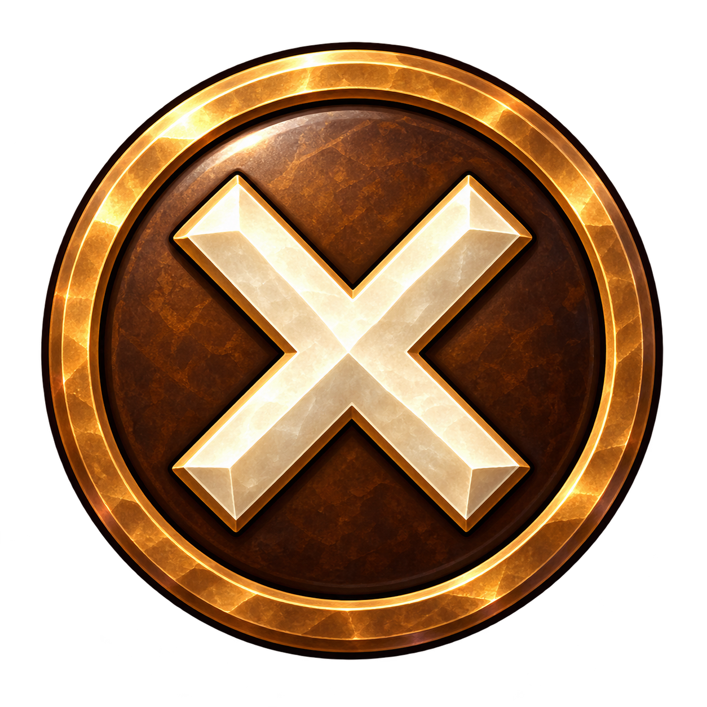
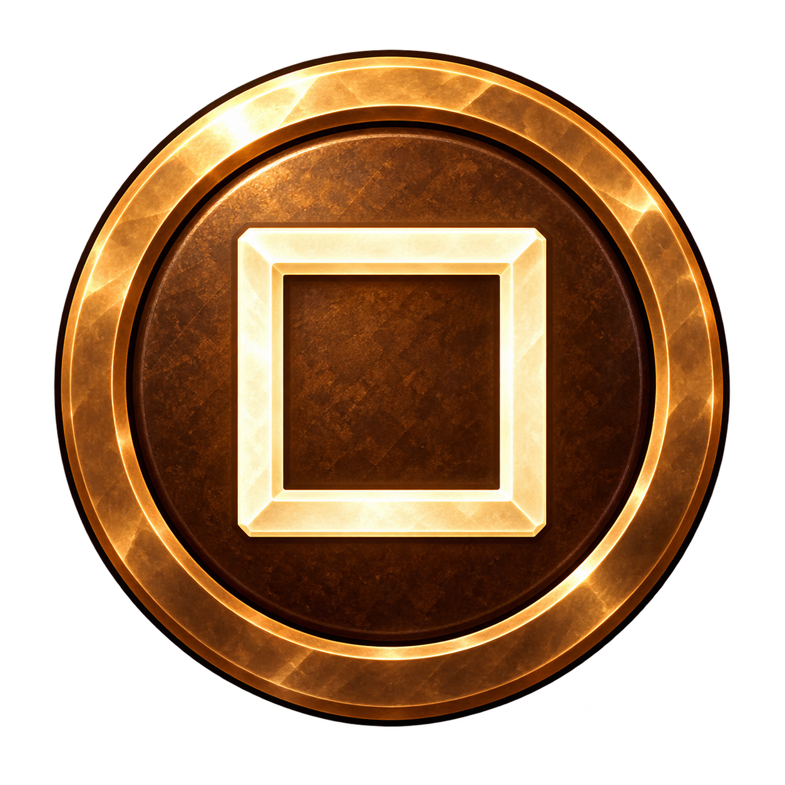
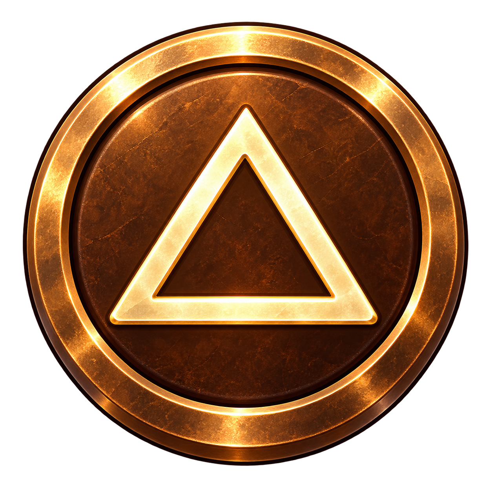
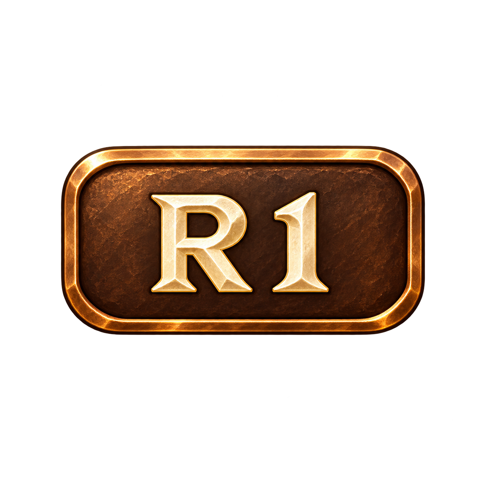
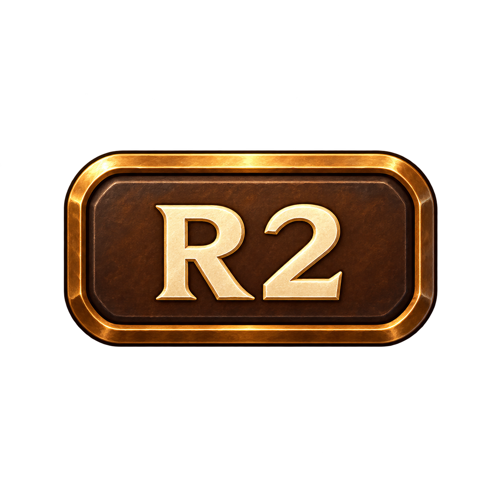
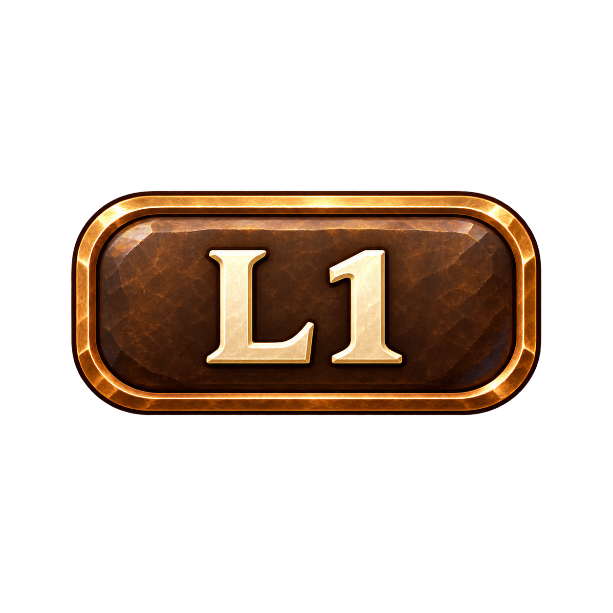
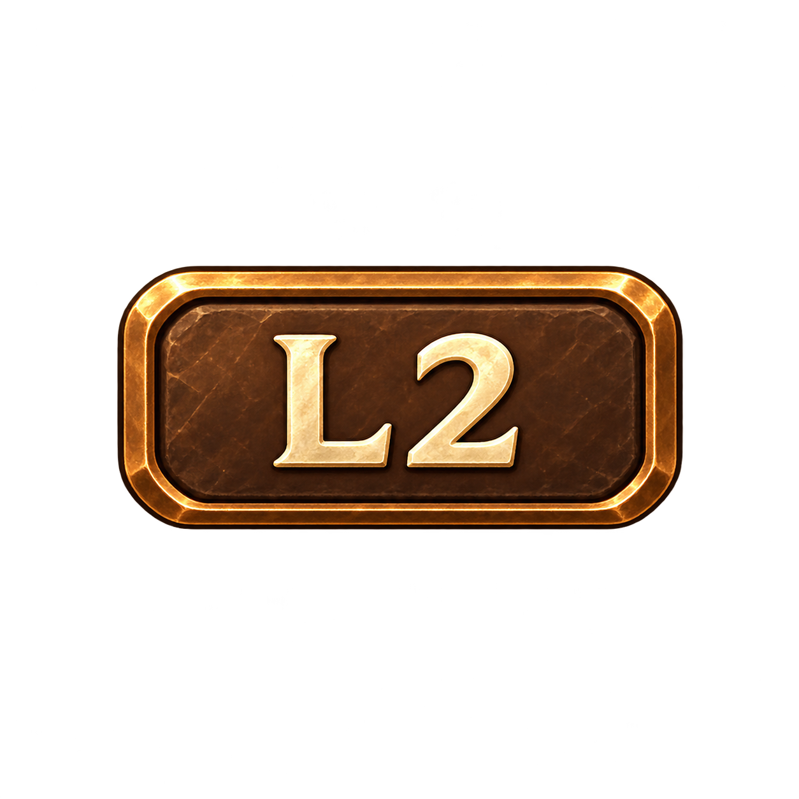
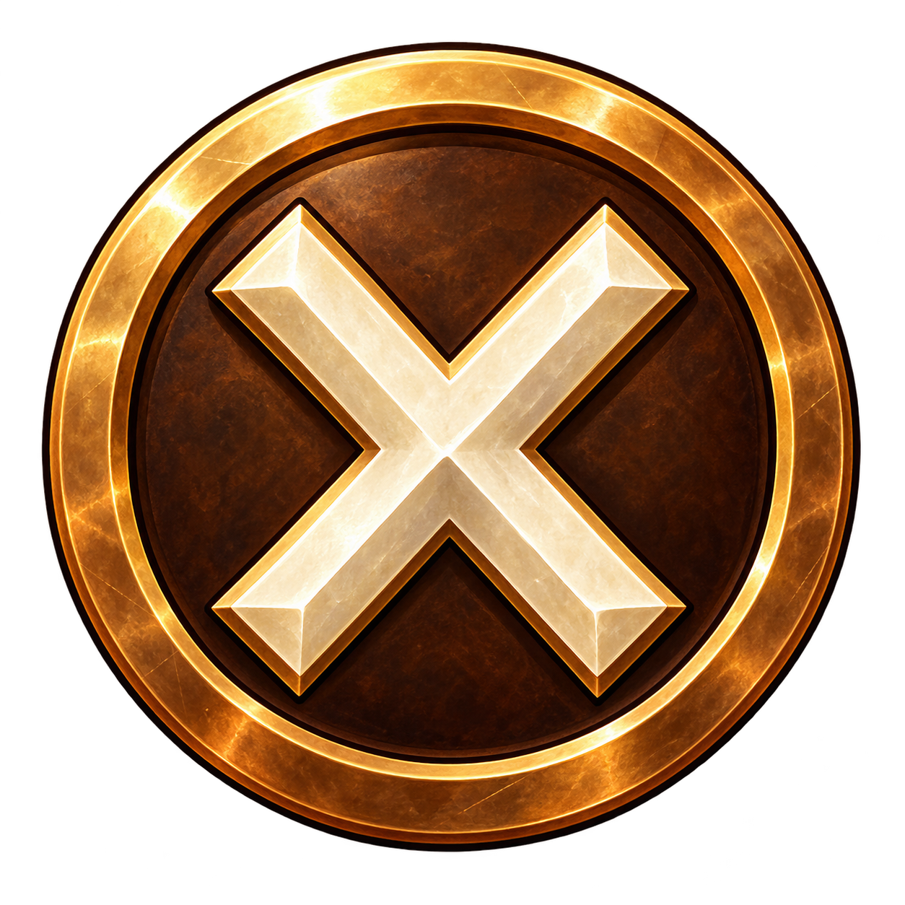
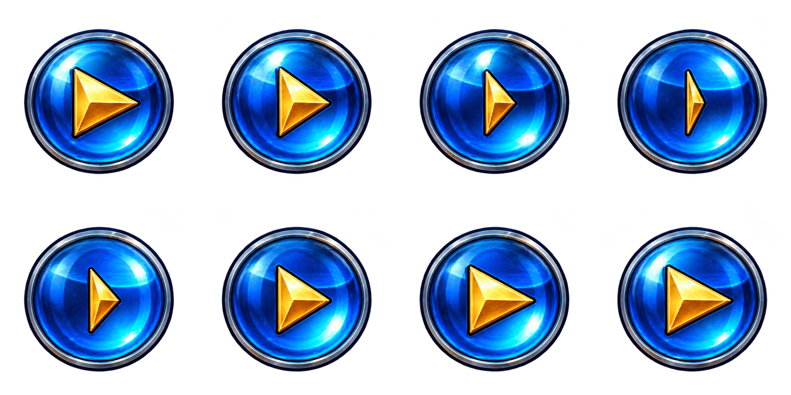
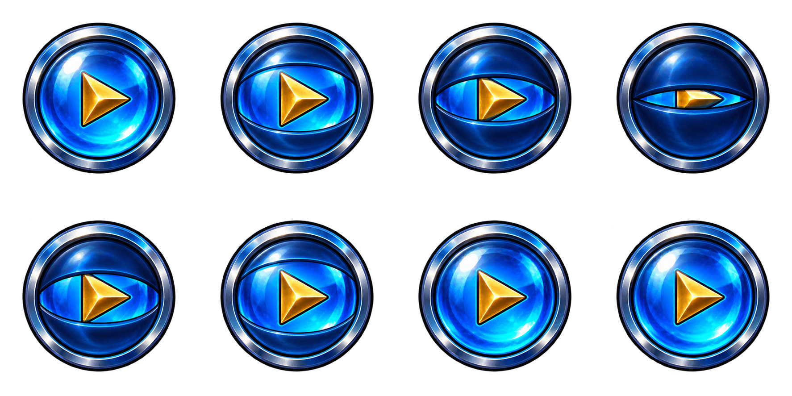

# Menu icon artwork review

Eight button prompts, two checkbox states and two eight-pose cursor sheets. Original triangles are reused through the player and dialogue masters, with colour and orientation recorded in the menu manifest. These are artwork candidates; the game is unchanged.

## Button Circle

## Button Cross

## Button Square

## Button Triangle

## Button R1

## Button R2

## Button L1

## Button L2

## Checkbox Unchecked

## Checkbox Checked

## Cursor Turn Poses

## Cursor Blink Poses

