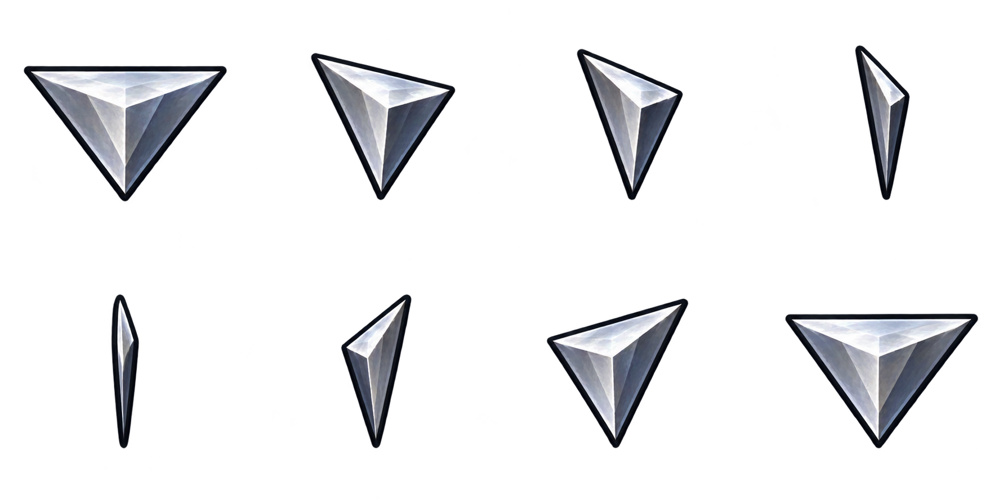
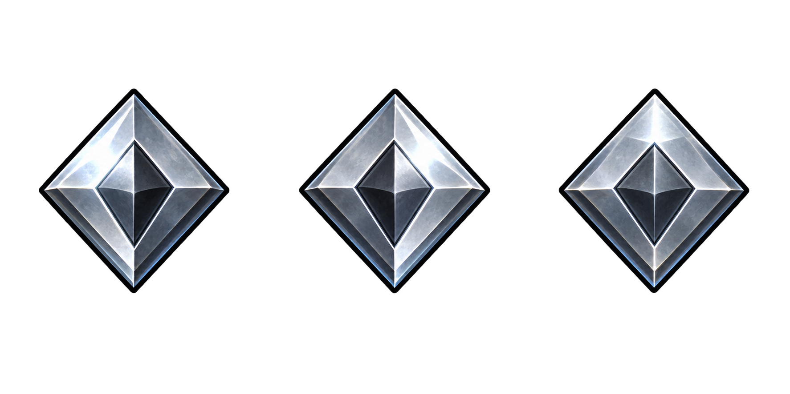
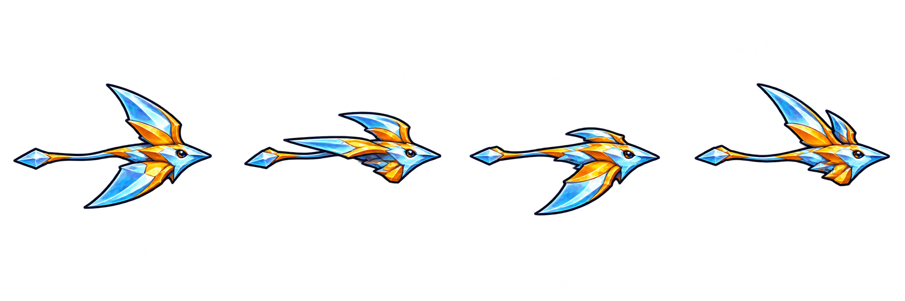
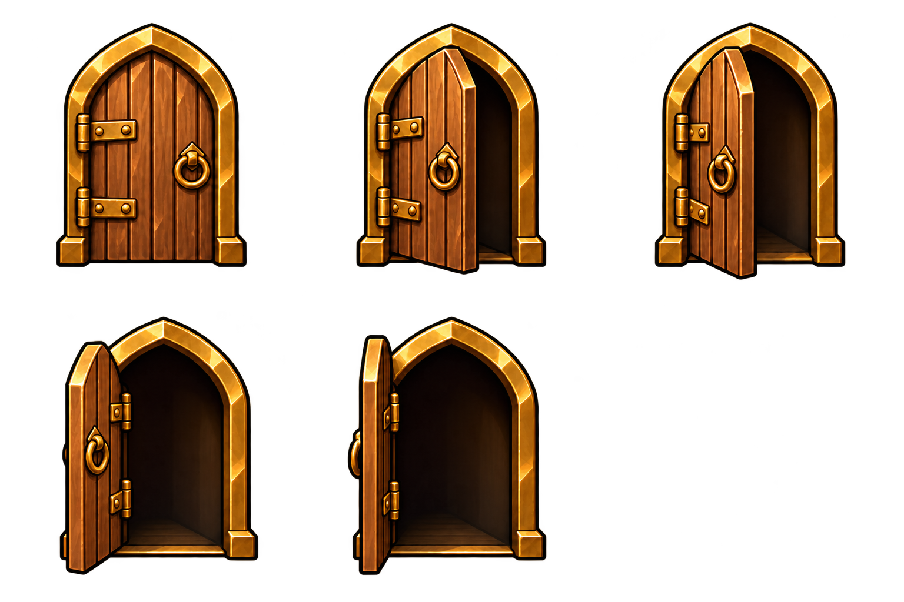
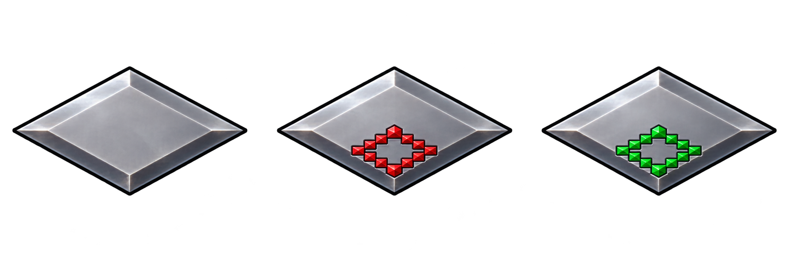
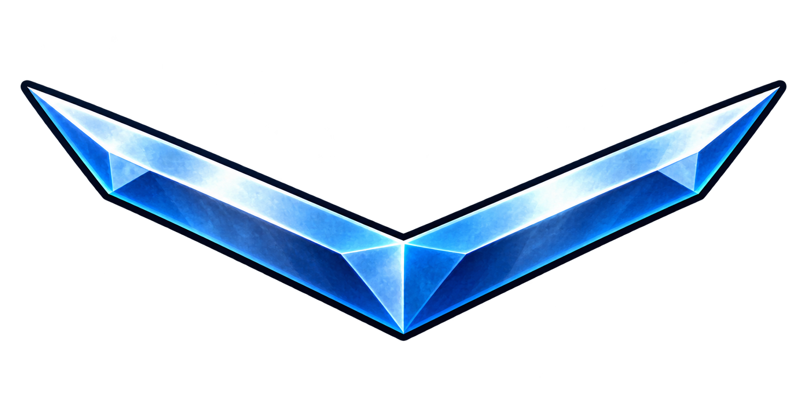

# World-map icon artwork review

Six selected masters cover24 distinct source frames/pieces: eight arrows, three destination diamonds, four Coolon flight poses, five Queen Fury door poses, three zoom-level diamonds and one shared zoom connector. Original L2/R2 text and bars stay unchanged. These are artwork candidates; the game is unchanged.

## Arrow Turn Poses

## Destination Diamond Poses

## Coolon Flight Poses

## Queen Fury Door Poses

## Zoom Level Diamond States

## Zoom Connector

